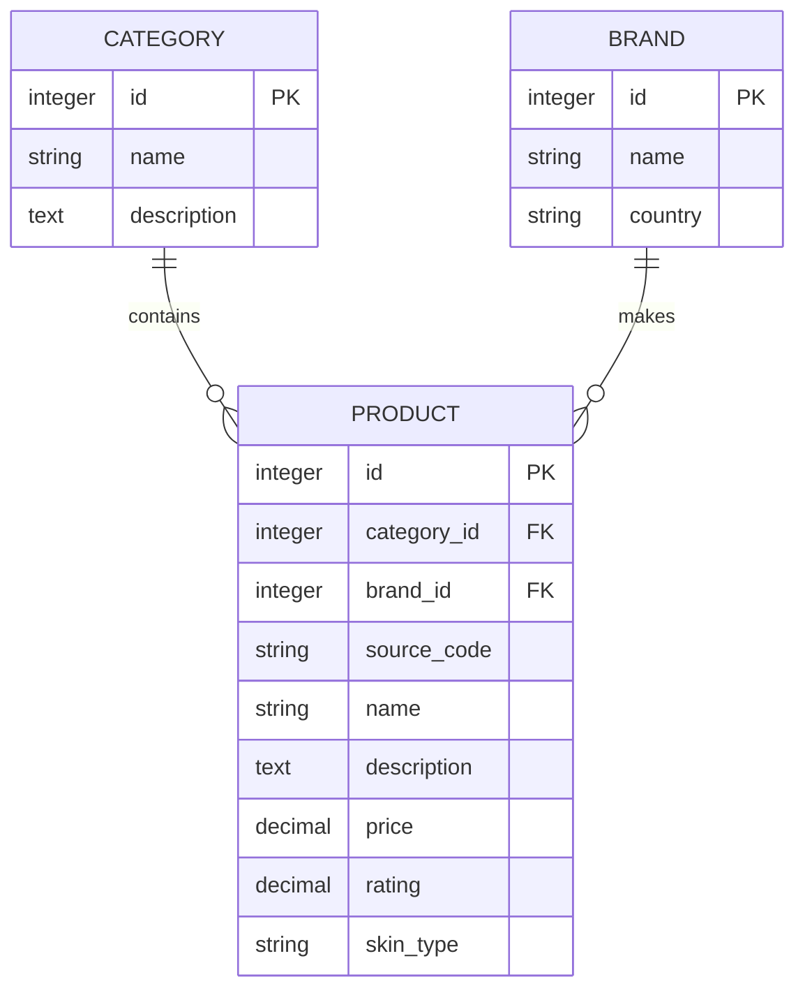

# Entity relationship diagram — Rubric 1.2

Each product belongs to exactly one category and one brand. Both parents can have many products. These associations are used in search, product pages, category pages and brand pages.
